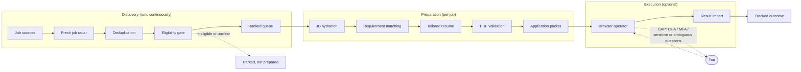

# Job Beast

**A job discovery and application orchestration system that catches high-fit roles early and turns them into truthful, application-ready packets.**

Fresh discovery → eligibility gates → job-description understanding → evidence-grounded resume tailoring → browser-operator handoff, with a human in the loop exactly where one is needed.

[](https://github.com/VishalkiranRaichur/VishalJobBeast/actions/workflows/ci.yml)
[](pyproject.toml)
[](LICENSE)

> **The job description may change what we emphasize. It may never change what is true.**
>
> Job Beast reorders verified skills, picks the most relevant projects, and uses the employer's wording when it maps to real evidence. It will not invent a language, an experience, a metric, a legal answer, or eligibility.

---

## Why I built it

Internship recruiting had two problems I kept running into.

First, good roles move fast. A strong posting can be crowded within hours, so finding it early matters.

Second, every application repeats the same work: read the posting, check whether I'm actually eligible, decide which projects fit, tailor the resume, and fill the same form fields again.

I wanted a system that could react quickly without trading away accuracy. It should find a new posting, rule out roles I can't take, understand what the role needs, and build the strongest resume my *verified* experience supports. It should then hand me a clean packet, or hand it to a browser operator, and stop to ask whenever a decision is mine to make.

That became Job Beast.

## How it works



The radar and the application side are decoupled. `watch` keeps syncing and re-ranking sources on its own schedule. Jobs that have been handed to an operator, parked for a human, or submitted are frozen, so the radar never pulls them back into the queue.

## What makes Job Beast different

### Freshness without sacrificing fit
Fit and freshness are separate signals. Freshness is a bounded bonus (at most +15) that only applies once a job clears a minimum fit score. A role posted ten minutes ago that barely matches cannot jump ahead of a strong match from yesterday. Only postings that are both very new (≤3 hours) *and* high-fit (≥70) enter the fast lane.

### Evidence-grounded tailoring
Every requirement in a job description is matched against a bank of stable, verified evidence items (`EXP-*`, `PROJ-*`, `SKILL-*`, `METRIC-*`). Each resume bullet traces back to one of them. Requirements with no supporting evidence stay *reported gaps*; they never become resume claims.

### Eligibility before expensive work
Hard requirements are checked before any resume is built or any browser opens:
- U.S.-person / export-control and citizenship requirements
- no-sponsorship postings, when the profile needs sponsorship
- mandatory graduate degrees, high-school-only roles, and explicit graduation windows
- security clearance and mandatory locations
- student-visa exclusions

Clear failures are marked ineligible. Anything ambiguous is parked as *needs confirmation* instead of guessed.

### Cross-source deduplication
The same role often appears in several feeds. Job Beast merges listings by fingerprint, URL, and a normalized company + role key. A direct employer URL replaces an aggregator page, and a prior submission for the same role blocks preparing it again.

### Failure isolation
A broken source, an unreachable posting, a failed PDF compile, or an unsupported form fails *that item only*. The radar logs a transient failure and keeps the other sources running; batch preparation records the failure and moves to the next job.

### Human boundaries
CAPTCHA and MFA are never automated, and legal or sensitive questions are answered only from answers you confirmed for the same question. Otherwise the job is parked in an explicit state (`READY_FOR_HUMAN_CAPTCHA`, `READY_FOR_HUMAN_MFA`, `NEEDS_INPUT`) and waits for you. Voluntary EEO answers, if you choose to store them, live only in your private vault and never enter a packet.

## Engineering problems behind Job Beast

**Freshness vs. relevance.** Being early matters, but the newest job is not automatically the best one. The queue priority is `fit + freshness_bonus`, where the bonus decays across age bands (1h, 3h, 6h, 12h, 24h) and is withheld below a fit floor. Stale fast-lane entries are demoted on every re-rank.

**Canonical identity.** One opening can arrive through Simplify, LinkedIn, and the employer's own ATS page, each with different URLs and IDs. The store resolves a canonical job by fingerprint or URL, falls back to a normalized company + title key, and records every listing as provenance instead of creating duplicates.

**Evidence grounding.** "Tailor aggressively" and "never hallucinate" pull in opposite directions. The matcher classifies each requirement as an exact, umbrella, adjacent, or unsupported match against evidence IDs. The resume builder may only emit bullets and skills that carry those IDs, and validation rejects forbidden terms such as unverified project names.

**State management.** Jobs move through a persisted state machine (queued, ready for operator, needs input, ready for human CAPTCHA/MFA, submitted, submitted-unverified, ineligible, closed). The radar re-ranks constantly, so it has to know which states it may never disturb, and duplicate submissions have to be blocked across sources.

**Failure isolation.** Discovery, preparation, and execution fail independently. Each source sync, each job in a batch, and each operator result is handled in its own error boundary and recorded, so one bad posting never stalls discovery.

**Application confirmation.** A clicked Submit button proves nothing: forms fail validation, sessions expire, and redirects land on error pages. An outcome only becomes `SUBMITTED` with independent employer confirmation (a confirmation page or message). Otherwise it is recorded as `SUBMITTED_UNVERIFIED`, which still blocks a duplicate application.

## Real-world use

Job Beast has been used across **100+ real-world internship application workflows** during development. That meant real postings from Greenhouse, Lever, Ashby, SmartRecruiters, Workday, Jobvite, and others, with all their edge cases: stale listings, JavaScript-only pages, reworded legal questions, custom dropdowns, verification codes, and confirmation pages that never arrive.

Much of the state machine, the eligibility gates, and the "confirmation or it didn't happen" rule came directly from those runs.

## Core capabilities

| Capability | What it does |
|---|---|
| Fresh job discovery | Syncs sources on demand (`fresh`) or on a schedule (`watch`). |
| Freshness ranking | Queue priority = fit + bounded freshness bonus; fast lane for new, high-fit roles. |
| Deduplication | Fingerprint / URL / company+role merging, with provenance kept. |
| Hard eligibility filtering | Citizenship, sponsorship, degree level, graduation window, clearance, location, visa. |
| JD hydration | Fetches the official posting text; thin pages are parked as `NEEDS_HYDRATION`. |
| JD analysis | Keeps employer wording, normalizes aliases, classifies each requirement. |
| Verified-evidence matching | Exact / umbrella / adjacent / unsupported matches against evidence IDs. |
| Tailored resume generation | LaTeX resume built only from selected verified evidence. |
| PDF validation | One page, required text present, no clipped or overlapping text, no forbidden terms. |
| Application handoff | Packet, operator instructions, and a result template per job. |
| Human verification states | CAPTCHA, MFA, and sensitive questions park the job for you. |
| Result tracking | Imports operator results; confirmation required for `SUBMITTED`. |
| Failure isolation | Per-source, per-job, and per-result error boundaries. |

## Sources

Job Beast separates **discovery sources** (where new jobs come from) from **ATS detection and hydration** (what happens once a job's URL is known).

| Layer | What's supported today |
|---|---|
| Discovery: Simplify | First-class source: the SimplifyJobs internship `listings.json` feed (`fetch-simplify`, `fresh`, `watch`). |
| Discovery: LinkedIn via Apify | Optional. Public, logged-out search through your own Apify token (`fetch-linkedin`, `watch --sources linkedin`). |
| Discovery: JobSpy | Optional extra for Indeed, Google Jobs, ZipRecruiter, and Glassdoor (`fetch-jobspy`). |
| ATS detection & hydration | When a discovered URL points at an ATS (Greenhouse, Lever, Ashby, SmartRecruiters, Workday, iCIMS, SuccessFactors, and others), Job Beast detects the provider and fetches the official posting text. |

Job Beast does **not** currently poll ATS boards directly as discovery sources; an ATS is reached through a URL that a discovery source found. Direct board polling is on the roadmap.

## Resume intelligence

```text
Job description
  → requirements extracted, employer wording preserved
  → classified (technical, domain, responsibility, education, eligibility/logistics, nice-to-have)
  → matched against verified evidence
  → experiences, projects, skills, and bullets selected
  → LaTeX generated
  → PDF compiled and validated
```

Logistics such as work authorization, location, or graduation timing are tracked separately, so they never count as technical keyword gaps.

A tiny example of the rule that matters most:

```text
Job asks for:      Python, SQL, C++
Verified evidence: Python ✅   SQL ✅   C++ ❌

Resume skills:     Python, SQL
Coverage report:   C++ → UNSUPPORTED (reported gap, not added)
```

Each tailored run writes the LaTeX source, the PDF, a PNG preview, a requirement-coverage report (JSON and Markdown), and the validation result.

## Browser operator handoff

Job Beast does not bundle a browser agent. It prepares everything an operator needs and imports what the operator reports back:

```text
Job Beast prepares  →  a compatible browser operator executes  →  Job Beast imports the result
   (handoff)                (fills the live application)              (import-result)
```

Claude in Chrome is one operator that works with this contract; any agent that can read the packet and write the result file can be used. The operator instructions encode the rules:

- Submission happens only when you authorize it (`--authorize-submission`).
- CAPTCHA and MFA are left for you.
- Legal, sponsorship, and sensitive questions use only answers you confirmed for the same question; anything else comes back as `NEEDS_INPUT`.
- Success requires employer confirmation; otherwise the result is `SUBMITTED_UNVERIFIED`.

There is also an optional Playwright layer (`jobbeast apply`) for deterministic form filling without an AI agent.

## Quick start

Requirements: Python 3.10+. For PDF output and validation, also install [tectonic](https://tectonic-typesetting.github.io/) and poppler (`brew install tectonic poppler`, or `apt install poppler-utils` plus tectonic). Requirement parsing and dry runs work without them.

```bash
# 1. Clone and install
git clone https://github.com/VishalkiranRaichur/VishalJobBeast.git
cd VishalJobBeast
python3 -m venv .venv
source .venv/bin/activate
pip install -e ".[dev]"

# 2. Environment (every variable is optional)
cp .env.example .env
set -a; source .env; set +a

# 3. Verify the install against the fictional example profile
python -m pytest -q
jobbeast doctor
jobbeast init

# 4. Try the tailoring pipeline on a bundled job description
#    (add --dry-run if tectonic/poppler aren't installed)
jobbeast tailor examples/epic_games_data_science_intern.json --output-dir output/demo

# 5. Discover and rank fresh jobs
jobbeast fresh --top 25
```

Then point it at your own profile (next section) and keep the radar running:

```bash
jobbeast watch --sources simplify --interval 30   # re-sync every 30 minutes
jobbeast next                                     # highest-priority eligible job
jobbeast handoff <JOB_ID>                         # resume + packet + operator instructions
```

## Candidate profile

`profiles/example/` is a **fictional** candidate ("Alex Rivera") so the project runs and tests pass out of the box. To use your own data, copy it:

```bash
cp -r profiles/example profiles/me
export JOBBEAST_PROFILE=me
cp profiles/me/application_answers.example.yaml profiles/me/application_answers.yaml
cp profiles/me/answers.private.example.yaml   profiles/me/answers.private.yaml
```

| File | Purpose |
|---|---|
| `profile.yaml` | Identity, education, experience with claims, core skills, optional sponsorship preferences. |
| `projects/*.yaml` | One file per project. Only `verified: true` projects are ever used; `type` and `tags` guide selection. |
| `evidence.yaml` | Stable evidence items; every resume bullet must trace to one. |
| `application_answers.yaml` | Standard form answers. Unknowns stay `REQUIRES_USER_INPUT`. |
| `answers.private.yaml` | Private vault for answers you have personally confirmed, including optional voluntary EEO answers. |

Everything under `profiles/` except `profiles/example/` is gitignored, and private answer files stay ignored even inside the example directory. To keep your data entirely outside the repository, set `JOBBEAST_PROFILE_DIR=/absolute/path/to/profile`.

## Configuration

`config.yaml` controls the recruiting season and feed URL, target titles and locations, the optional LinkedIn/Apify search, and automation limits (daily and per-run caps, minimum fit score). Job Beast was originally built for internship recruiting, and the season, roles, locations, and candidate profile are all configurable.

<details>
<summary><b>More commands</b></summary>

```bash
# Discovery
jobbeast fetch-simplify
jobbeast fetch-linkedin --dry-run          # print search URLs, no Apify call
jobbeast fetch-linkedin --top 25           # needs APIFY_TOKEN
jobbeast watch --sources simplify linkedin --interval 60
jobbeast list --limit 20 --min-score 55
jobbeast hydrate <JOB_ID>

# Analysis and tailoring
jobbeast validate-evidence
jobbeast parse-jd examples/epic_games_data_science_intern.json
jobbeast tailor examples/epic_games_data_science_intern.json --output-dir output/demo --dry-run
jobbeast coverage examples/epic_games_data_science_intern.json --output-dir output/demo

# Handoff and results
jobbeast handoff <JOB_ID> --authorize-submission
jobbeast handoff-batch --limit 5
jobbeast import-result <JOB_ID>
jobbeast dashboard
jobbeast export-csv

# Optional Playwright automation (pip install -e ".[apply]" && playwright install chromium)
jobbeast apply <JOB_ID> --dry-run
jobbeast apply <JOB_ID> --headed
jobbeast apply <JOB_ID> --submit --headed
```

</details>

### LinkedIn via Apify (optional)

- Uses an [Apify](https://apify.com) actor to read **public, logged-out** LinkedIn job search results. You need your own Apify account and `APIFY_TOKEN`; Apify bills per result.
- Never supply LinkedIn cookies, session state, or credentials. Job Beast never asks for them and ships no authenticated LinkedIn state.
- You are responsible for complying with the terms of LinkedIn, Apify, and any other site you use.
- Rate limiting can drop some results; the radar tolerates it. Without a token, the LinkedIn commands exit with a clear message and Simplify keeps working.

## Privacy and safety

Job Beast is built around private candidate data, so the defaults are conservative:

- `.env`, private profiles, and answer vaults are gitignored.
- Runtime databases, generated resumes, packets, and results under `output/` are gitignored.
- Browser profiles, cookies, session and storage state are gitignored.
- Voluntary EEO answers are stripped before any packet or operator prompt is built.
- Job descriptions are treated as untrusted data; instructions inside a posting are never followed.
- Job Beast does not bypass CAPTCHA or MFA.

See [SECURITY.md](SECURITY.md) for the full list of what must never be committed and how to report a vulnerability.

## Project structure

```text
src/jobbeast/
  sources/            discovery: Simplify, LinkedIn (Apify), JobSpy
  radar.py            fresh radar, ranking, queue
  store.py            SQLite store, dedup, state machine
  eligibility.py      hard eligibility gates
  hydration.py        official posting fetch + ATS detection
  jd.py, matching.py  requirement extraction and evidence matching
  resume_builder.py   tailored LaTeX resume
  validation.py       PDF quality gate
  handoff.py          operator packets and result import
  apply/              optional Playwright form automation
profiles/example/     fictional candidate (copy this)
browser_extension/    optional Chrome companion
templates/            LaTeX resume layout
examples/             sample job descriptions
docs/                 architecture and setup notes
tests/                offline test suite
```

## Development and testing

```bash
pip install -e ".[dev]"
python -m pytest -q
```

The suite runs offline against the fictional profile, with no `.env`, network access, or private data. Tests that build real PDFs are skipped automatically when tectonic or poppler is missing; CI installs both and runs everything on every push. See [docs/ARCHITECTURE.md](docs/ARCHITECTURE.md) for internals.

## Roadmap

Directions already identified in [docs/FOLLOWUPS.md](docs/FOLLOWUPS.md):

- Stronger requirement extraction from sparse job descriptions
- Direct ATS board polling (Greenhouse, Lever, Ashby) as discovery sources
- Better merging of aggregator reposts with the employer's own listing
- Rendering JavaScript-only postings during hydration
- Wider student-visa exclusion detection

## Contributing and license

- [CONTRIBUTING.md](CONTRIBUTING.md): setup, ground rules, PR checklist
- [SECURITY.md](SECURITY.md): what never to commit; reporting vulnerabilities
- [LICENSE](LICENSE): MIT
- [THIRD_PARTY_NOTICES.md](THIRD_PARTY_NOTICES.md) and [UPSTREAMS.md](UPSTREAMS.md): attributions and upstream data sources

---

Created by [Vishalkiran Raichur](https://github.com/VishalkiranRaichur).
